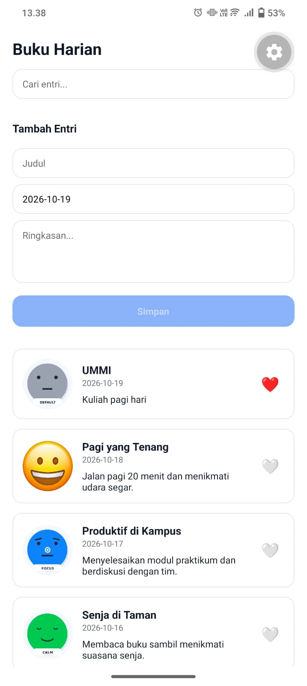

# Praktikum Pertemuan 2 - Diary App (React Native Expo)

Tugas Praktikum Mobile Programming: Struktur Project & Komponen Dasar (View, Text, Image, StyleSheet, Flexbox).

---

## Identitas Mahasiswa
* **Nama** : Muhammad Zulfachry
* **NIM**  : 2430511051
* **Program Studi** : Teknik Informatika
* **Perguruan Tinggi** : Universitas Muhammadiyah Sukabumi

---

## Langkah Menjalankan Proyek

1. **Clone Repository**
   ```bash
   git clone [https://github.com/muhamadzulfahry/mobile_multi.git](https://github.com/muhamadzulfahry/mobile_multi.git)
   cd mobile_multi

   ---

## Tangkapan Layar (Screenshot)

<p align="center">
  
</p>